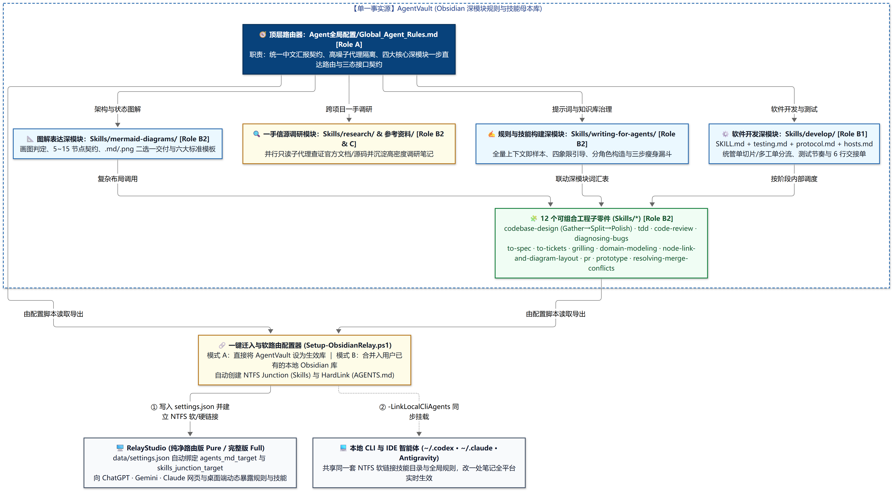
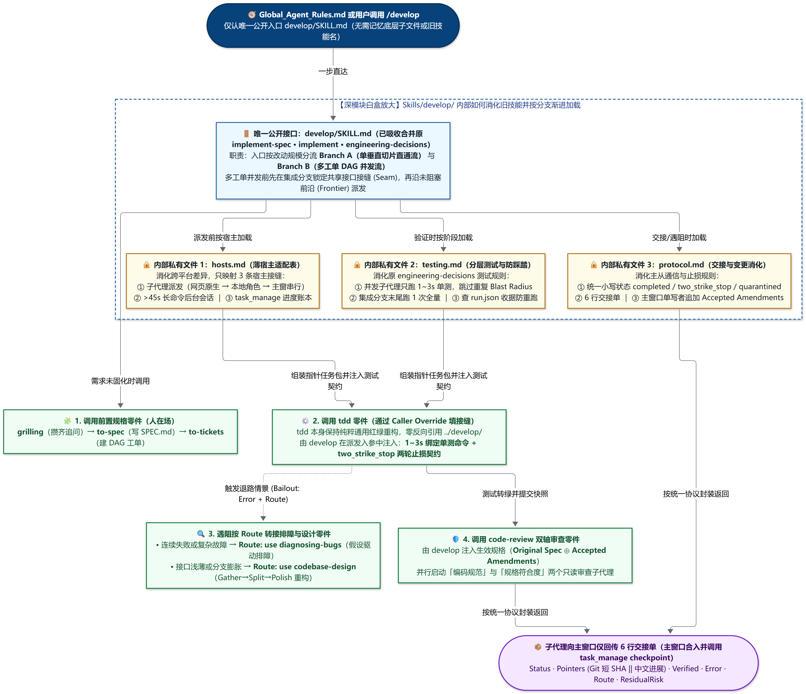
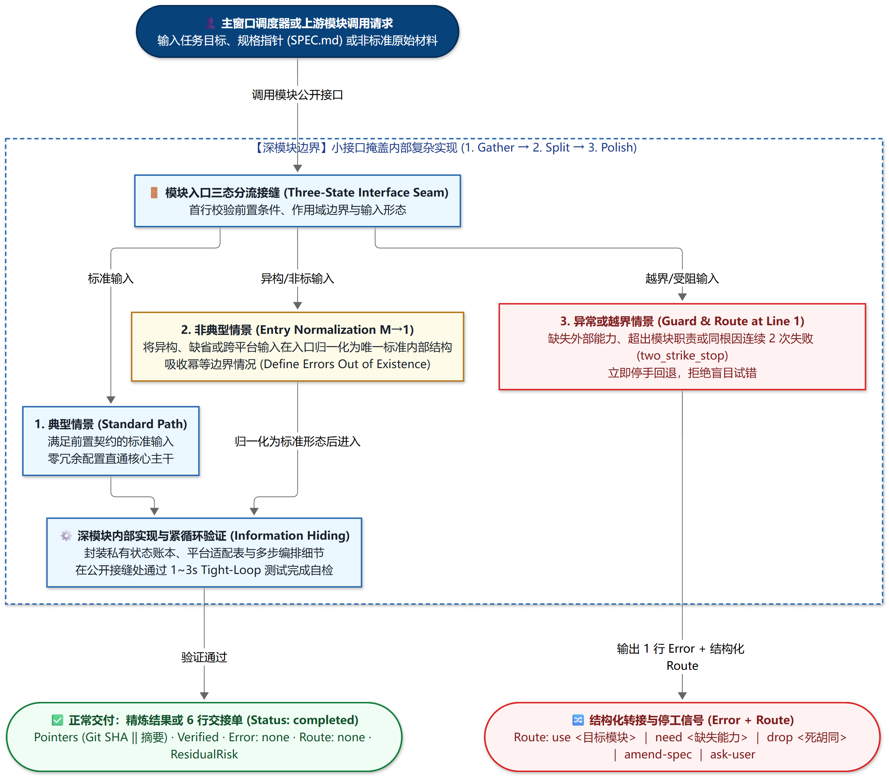

# AgentVault — 面向 RelayStudio 与多宿主 Agent 的 Obsidian 深模块规则与技能库

[](https://linux.do/)

**AgentVault** 是基于信息隐藏（Parnas）与深模块原则（Ousterhout *A Philosophy of Software Design*）构建的 **Obsidian 工程规则与技能母本仓库**。它可以作为独立 Obsidian 仓库直接打开，也可以通过仓库自带的 **`Setup-ObsidianRelay.ps1`** 一键合并进你现有的本地 Obsidian 仓库，并将 [**RelayStudio**](https://github.com/yuan88964/RelayStudio)（以及本机的 Codex / Claude / Antigravity）通过 NTFS 软/硬链接统一路由到你的 Obsidian 仓库，实现**“在 Obsidian 中修改一处规则或技能，全平台 Agent 实时同步生效”**。

---

## 一、全局版图与深模块内部白盒机制

### 1.1 全局深模块分层与多宿主软路由架构

<p align="center">
  
</p>

### 1.2 深模块内部白盒机制：以 `Skills/develop/` 为例看如何“消化旧技能、按接缝调子零件”

<p align="center">
  
</p>

### 1.3 深模块三态接口契约与结构化转接（`Standard / Normalize / Error + Route`）

<p align="center">
  
</p>

| 目录 / 入口文件 | 角色定位 | 说明 |
| :--- | :--- | :--- |
| **[`Agent全局配置/Global_Agent_Rules.md`](Agent全局配置/Global_Agent_Rules.md)** | 全库唯一顶层路由器（Role A） | 统一汇报语体契约、求真溯源与高噪隔离、四大核心深模块一步直达路由以及三态接口契约（`Standard / Normalize / Error + Route`） |
| **[`Skills/develop/SKILL.md`](Skills/develop/SKILL.md)** | 软件开发与长程编排深模块（Role B1） | 唯一软件开发入口：已消化合并原 `implement-spec`、`implement`、`engineering-decisions`，按规模自动分流单切片流与多工单 DAG 流，内部按分支渐进加载测试节奏（[`testing.md`](Skills/develop/testing.md)）、6 行交接与修订协议（[`protocol.md`](Skills/develop/protocol.md)）及多宿主适配（[`hosts.md`](Skills/develop/hosts.md)） |
| **[`Skills/codebase-design/SKILL.md`](Skills/codebase-design/SKILL.md)** | 深模块设计方法论底座（Role B2） | `1. Gather → 2. Split → 3. Polish` 深模块构造决策树与多工单并发四阶段防线，内部按需加载 [`DEEPENING.md`](Skills/codebase-design/DEEPENING.md) 与 [`DESIGN-IT-TWICE.md`](Skills/codebase-design/DESIGN-IT-TWICE.md) |
| **[`Skills/writing-for-agents/SKILL.md`](Skills/writing-for-agents/SKILL.md)** | 提示词、技能与知识库构建深模块（Role B2） | 全量上下文即样本、双重负载权衡、四象限引导，以及按 `Gather → Split → Polish` 构造与打磨 A/B1/B2/C 四类文档角色，内部按需加载 [`SKILL-MECHANICS.md`](Skills/writing-for-agents/SKILL-MECHANICS.md) |
| **[`Skills/mermaid-diagrams/SKILL.md`](Skills/mermaid-diagrams/SKILL.md)** | 系统架构与图解表达深模块（Role B2） | 画图判定、5～15 节点规模契约、`.md`/`.png` 二选一交付与 C4 / 时序 / 状态 / 瑞士奶酪六大标准模板，内部按图型加载 `references/*.md` |
| **[`Skills/`](Skills/) 其余 12 个工程子零件** | 原子执行与评审零件（Role B2） | 包含 `tdd`、`code-review`、`diagnosing-bugs`、`to-spec`、`to-tickets`、`grilling`、`domain-modeling`、`node-link-and-diagram-layout`、`research`、`resolving-merge-conflicts`、`pr`、`prototype`（预留 `Caller Override` 接缝，零反向引用上层编排器） |
| **[`参考资料/00 参考资料导览.md`](参考资料/00%20参考资料导览.md)** | 软件设计调研笔记（Role C） | 收录面向过程/面向对象/信息隐藏演进调研，以及复杂度控制、深模块构造与多工单并发设计深度调研 |
| **[`Setup-ObsidianRelay.ps1`](Setup-ObsidianRelay.ps1)** | 一键迁入与软路由配置器 | 支持将本库合并进你已有的本地 Obsidian 仓库，并自动将 RelayStudio（含纯净路由版 `pure-portable`）软路由挂载至该 Obsidian 仓库 |

---

## 二、两种一键配置方式（配合 RelayStudio 纯净路由版或完整版）

你可以下载 [**RelayStudio 纯净路由版（`RelayStudio-v1.3.0-win-x64-pure-portable.zip`）**](https://github.com/yuan88964/RelayStudio/releases/latest)（不内置任何预设规则与技能），再通过本仓库的 `Setup-ObsidianRelay.ps1` 完成一键挂载：

### 方式 A：把本仓库的内容直接配置到你**已有的本地 Obsidian 仓库**中，并将 RelayStudio 软路由过去（推荐）

如果你本地已经有日常使用的 Obsidian 知识库（例如 `D:\MyObsidianVault`），只需克隆本仓库并运行：

```powershell
git clone https://github.com/yuan88964/AgentVault.git
cd AgentVault

# 将 Agent全局配置/、Skills/ 与参考资料合并至你现有的 Obsidian 库，并自动将 RelayStudio 软路由指向你的 Obsidian 库：
powershell -ExecutionPolicy Bypass -File .\Setup-ObsidianRelay.ps1 `
  -TargetObsidianVault "D:\MyObsidianVault" `
  -RelayStudioDir "D:\RelayStudio"
```

### 方式 B：直接把克隆下来的 `AgentVault` 作为独立 Obsidian 仓库打开并挂载 RelayStudio

```powershell
git clone https://github.com/yuan88964/AgentVault.git
cd AgentVault

# 直接将当前 AgentVault 软路由挂载至 RelayStudio：
powershell -ExecutionPolicy Bypass -File .\Setup-ObsidianRelay.ps1 `
  -RelayStudioDir "D:\RelayStudio"
```

> **底层做了什么？**
> `Setup-ObsidianRelay.ps1` 会自动在 `RelayStudio\data\settings.json` 中写入 `"agents_md_target"` 与 `"skills_junction_target"`，并将 `RelayStudio\engine-data\skills` 建立为指向你 Obsidian 仓库 `Skills/` 的 **NTFS Junction 软链接**，将 `RelayStudio\engine-data\AGENTS.md` 建立为指向 `Agent全局配置/Global_Agent_Rules.md` 的**硬链接**。如果加上 `-LinkLocalCliAgents` 参数，还会一并挂载到本机的 `~/.codex/skills` 与 `~/.claude/skills`。

---

## 友链与致谢

本项目积极参与并认可 **[LINUX DO 社区](https://linux.do)**（友链：https://linux.do ）。
